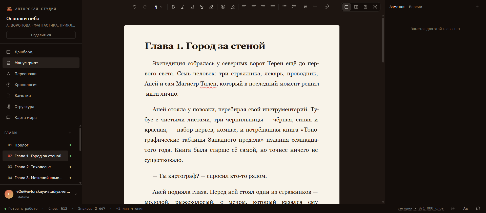
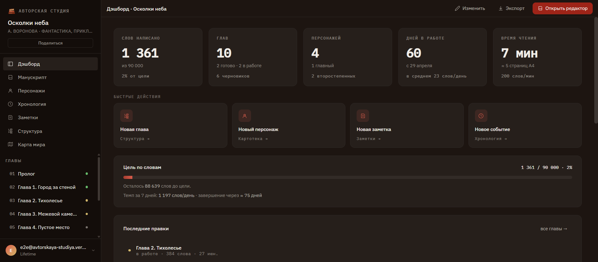
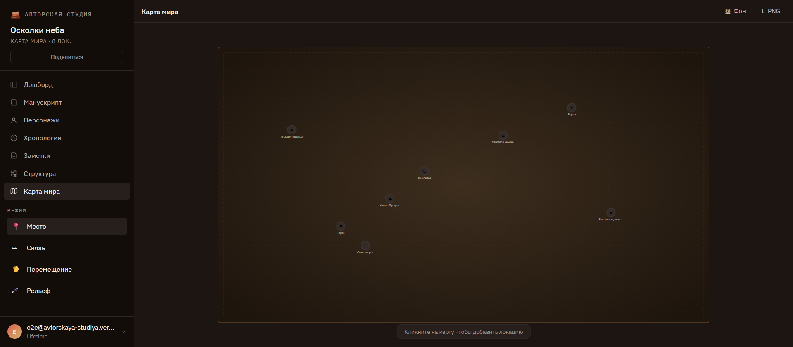
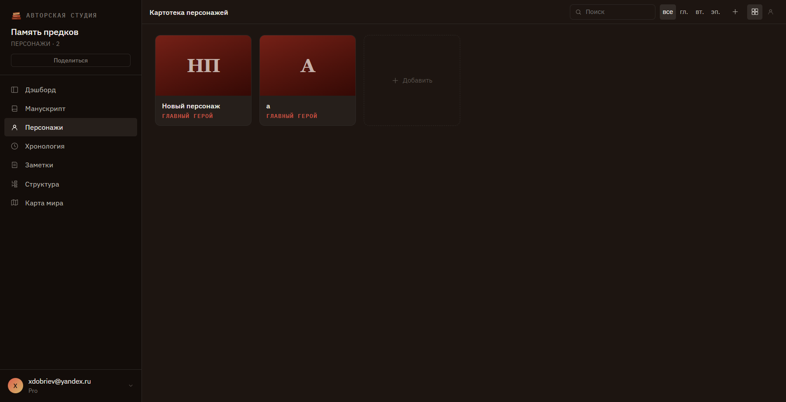
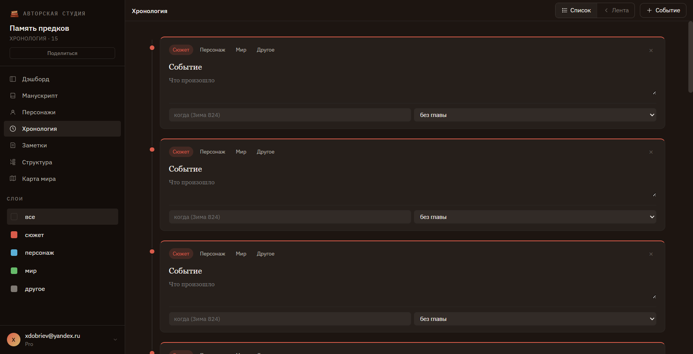

# Авторская студия

**Авторская студия — веб-редактор для работы над книгой целиком.** Рукопись, главы, персонажи, хронология и материалы о мире собраны рядом, чтобы автор мог сосредоточиться на тексте и не терять связи между его частями.

[Открыть сайт](https://avtorstudio.com) · [Попробовать демо без регистрации](https://avtorstudio.com/demo) · [Резервный адрес](https://avtorskaya-studiya.vercel.app)

## Как выглядит



В редакторе рукопись соседствует со структурой книги и заметками к главе. Отдельные инструменты помогают вести персонажей, события и локации.

| Дашборд книги | Карта мира |
|---|---|
|  |  |

| Персонажи | Хронология |
|---|---|
|  |  |

## Что можно делать

- Писать и структурировать книгу по главам; использовать режимы Outline, Corkboard, Focus и Split.
- Вести карточки персонажей, связи между ними и упоминания в главах.
- Раскладывать события по хронологии, а места и связи между ними — на карте мира.
- Оставлять заметки к книге и главам, отслеживать прогресс и историю версий.
- Экспортировать рукопись в DOCX, EPUB, FB2, PDF, HTML, Markdown и TXT.
- Продолжать книжную серию и переносить выбранные материалы из предыдущей книги.

## Инженерные решения

- **Редактор для длинного текста.** React и TypeScript формируют интерфейс, TipTap/ProseMirror — основу rich-text редактора. Данные книги разделены на главы и связанные с ними сущности: персонажей, события, заметки и локации.
- **Доступ к данным на уровне строк.** Supabase предоставляет Postgres и авторизацию. Политики Row Level Security ограничивают операции с пользовательскими данными владельцем (`auth.uid()`). Публичное чтение книги по ссылке реализовано отдельно через `share_token`.
- **Несколько форматов из одной рукописи.** Экспорт разделён по форматам: DOCX, EPUB и FB2 формируются отдельными модулями; HTML, Markdown и TXT — преобразованием структуры глав; PDF открывает подготовленную версию для печати.
- **Проверки и доставка автоматизированы через GitHub Actions.** Workflow запускает проверку типов, ESLint, модульные и E2E-тесты Playwright в Chromium, а также проверки сборки и инфраструктурных файлов. Отдельный workflow после успешного CI на `main` собирает приложение, публикует файлы на Timeweb VPS и выполняет smoke-проверку сайта.

## Технологии

| Область | Технологии |
|---|---|
| Интерфейс | React 18, TypeScript, Vite, Framer Motion |
| Редактор | TipTap, ProseMirror |
| Данные и авторизация | Supabase, PostgreSQL, Row Level Security, Edge Functions |
| Экспорт | `docx`, JSZip, генерация FB2/XML, HTML, Markdown и текста; печатная версия для PDF |
| Проверки и деплой | GitHub Actions, Vitest, Playwright, Nginx, Timeweb VPS |

### Структура проекта

```text
src/
  components/   интерфейс и компоненты редактора
  pages/        страницы приложения
  lib/          работа с данными, редактором и экспортом
  extensions/   расширения редактора TipTap
supabase/
  migrations/   схема базы данных и политики доступа
  functions/    серверные Edge Functions
.github/workflows/
                CI и автоматизация деплоя
```

## Локальный запуск

Нужен Node.js **22 или новее**.

```bash
npm install
cp .env.example .env
```

Заполни в `.env` `VITE_SUPABASE_URL` и `VITE_SUPABASE_ANON_KEY` значениями своего проекта Supabase, затем запусти приложение:

```bash
npm run dev
```

Vite откроет приложение на `http://127.0.0.1:5273`.

Основные команды:

```bash
npm run typecheck  # проверка TypeScript
npm run lint       # ESLint
npm run test       # модульные тесты
npm run e2e        # браузерные E2E-тесты Playwright
npm run build      # production-сборка
```

SQL-миграции лежат в `supabase/migrations/` и применяются к проекту Supabase по порядку.
